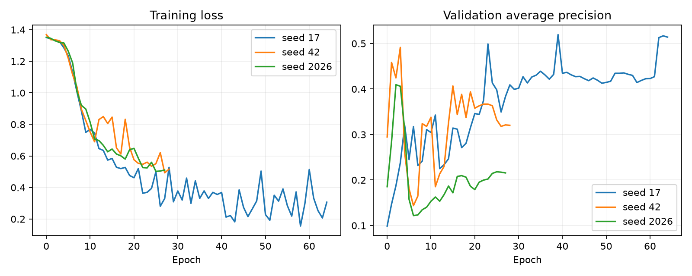
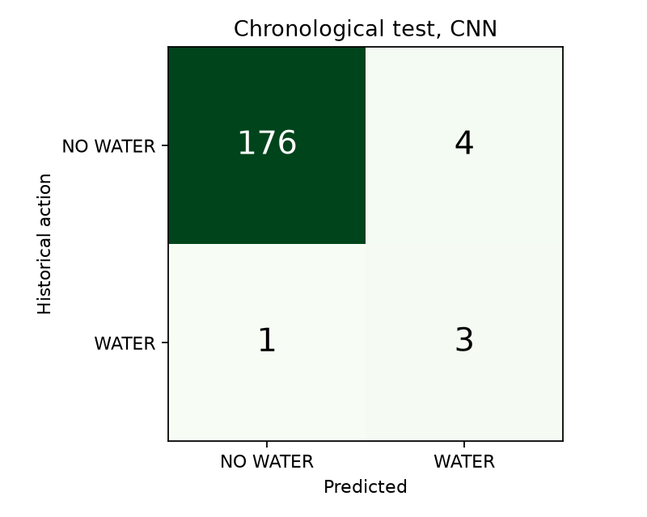

# CNN và quy trình dữ liệu

## Bài toán và giới hạn nhãn

Nguồn Mendeley DOI `10.17632/jtsyb593fy.1`, tác giả MD NAZMUL HOWLADER và Fatema Tuz Zohora Priyanka, CC BY 4.0. Tệp gốc chứa 960 dòng trong 20 ngày, mỗi 30 phút. Các cột gồm Timestamp, Day, Time, Temperature_C, Humidity_pct, Soil_Moisture_pct, Light_Intensity và Pump_Status. Xem `data/raw/source.json` để truy nguyên và SHA-256.

Có 28 dòng Pump_Status=1, tương đương khoảng 2,92%; nhiều dòng dương nằm liên tiếp cùng một lần tưới. Độ ẩm đất tại dòng bơm bật thường đã tăng. Nếu dùng cảm biến tại chính dòng đó để phân loại có thể học ảnh hưởng sau tưới. Do đó đầu vào gồm 8 mốc **trước** nhãn, dự báo trạng thái bơm ở mốc kế tiếp. Không dùng Pump_Status, Day, Time hoặc cảm biến tại mốc nhãn làm đặc trưng.

`WATER` trong mô hình công khai có nghĩa dự báo hành vi tưới lịch sử. Nó chưa chứng minh cây thực sự cần tưới hoặc số giây là tối ưu. Nhãn thực `water_needed` phải được xác minh độc lập. Giờ gốc không ghi múi giờ nên không thêm đặc trưng giờ tuyệt đối vào mô hình; thứ tự và khoảng cách 30 phút được giữ nguyên.

## Tiền xử lý và chống rò rỉ

Chuyển cột sang tên chuẩn, kiểm tra nhãn nhị phân, timestamp trùng, phạm vi cảm biến và khoảng lấy mẫu. Giá trị cảm biến thiếu/ngoài phạm vi được xem là thiếu; median chỉ fit trên train. Mean và standard deviation cũng chỉ tính trên train. Không nội suy dùng tương lai. Đầu vào inference không hợp lệ sẽ quay về ngưỡng.

Chia raw timeline **60% train / 20% validation / 20% test trước khi tạo cửa sổ**. Không có raw row dùng chung giữa các tập. Mỗi tập bỏ 8 mốc đầu cho cửa sổ, tạo 568/184/184 mẫu; nhãn dương tương ứng 18/6/4. Không shuffle toàn dataset để chia tập. Shuffle minibatch chỉ diễn ra bên trong train.

## Kiến trúc

Tensor đầu vào `[batch, 4 cảm biến, 8 mốc]`. Các khối Conv1D kernel 3, GELU, dropout, khối convolution dilation 2; ghép pooling trung bình với vector mốc cuối; dense head tách classification và regression. Conv có padding đối xứng trong cửa sổ quá khứ, nên không đọc dữ liệu vượt quá thời điểm phát dự báo.

Phân loại dùng BCEWithLogitsLoss với `pos_weight = N_negative/N_positive`. Hồi quy dùng SmoothL1 trên số giây chuẩn hóa 0–30, chỉ áp dụng mẫu WATER có nhãn thời lượng thật. Nhánh hồi quy chưa được huấn luyện ở checkpoint công khai; inference không xuất số từ head chưa train.

Train AdamW, learning rate 0,001, weight decay 0,01, batch 64, gradient clipping 1, tối đa 160 epoch, ReduceLROnPlateau và early stopping 25 epoch không cải thiện. Ba cấu hình `(channels, dropout)`: `(8,0.1)`, `(16,0.2)`, `(32,0.3)`, mỗi cấu hình chạy seed 17, 42, 2026. Chọn cấu hình theo trung bình điểm validation các seed; dùng ensemble ba seed của cấu hình được chọn. Ngưỡng quyết định chọn theo F1 validation, tie-break precision rồi threshold. Không điều chỉnh theo kết quả test.

CUDA được kiểm tra trước khi train. Bộ mã bật deterministic algorithms, đặt seed và CUBLAS_WORKSPACE_CONFIG. FP32 được dùng vì mạng và dataset nhỏ; mixed precision không tự bảo đảm kết quả tốt hơn. Cấu hình được chọn là 32 kênh, dropout 0,3. Metadata lưu thiết bị, phiên bản PyTorch, hash CSV, ngưỡng và ranh giới chia tập.

## Kết quả thực tế

| Mô hình | Accuracy | Precision | Recall | F1 | Average precision |
|---|---:|---:|---:|---:|---:|
| CNN 1D ensemble | 0,9728 | 0,4286 | 0,7500 | 0,5455 | 0,6778 |
| Logistic Regression | 0,9891 | 1,0000 | 0,5000 | 0,6667 | 0,6117 |
| Decision Tree | 0,9783 | 0,5000 | 1,0000 | 0,6667 | 0,5000 |
| Random Forest | 0,9783 | 0,5000 | 0,2500 | 0,3333 | 0,6917 |
| Ngưỡng đất dưới 30% | 0,9783 | 0 | 0 | 0 | 0,0217 |
| Luôn NO WATER | 0,9783 | 0 | 0 | 0 | 0,0217 |

CNN: TN=176, FP=4, FN=1, TP=3. Tập test chỉ 184 mẫu, 4 dương, nên kết quả rất nhạy với một lỗi. Accuracy của mô hình luôn NO WATER còn cao hơn CNN; đây là minh họa tại sao không đánh giá bằng Accuracy đơn độc. Ngưỡng 30% không kích hoạt vì đất trong dataset luôn trên 46%; bảng đối chứng không có nghĩa ngưỡng 30% sai với mọi loại đất. Nó cho thấy khác biệt giữa hiệu chuẩn nguồn và chậu cần triển khai.

Khóa `pr_auc` trong JSON lưu `sklearn.average_precision_score` (average precision, không phải tích phân hình thang PR). Không tuyên bố CNN thắng tất cả baseline. Những lần tìm cấu hình nằm trong `search.json`; `test_predictions.csv` chứa mọi dự đoán test để kiểm tra lại.

## Inference và điều khiển

`Predictor.predict(history)` dùng cùng thứ tự đặc trưng và scaler. Telemetry 10 giây được đưa về mốc 30 phút bằng bản ghi cuối mỗi bin, chỉ dùng bin đã kết thúc. Không bù bin trống, không dùng bin chưa hoàn thành. Cần đủ 8 bin; chuỗi chưa đủ trả `available=false`. CNN dự báo kỳ kế tiếp 30 phút, không phải cam kết thời điểm cây thiếu nước chính xác.

Đầu ra gồm `prediction`, `water_probability`, `duration_seconds`, `duration_source`, `forecast_horizon_seconds`, `reason`, `model_version`. Khi không có nhãn regression, duration là null từ module AI; controller bổ sung xung cấu hình và ghi rõ `configured_pulse`.

Mô hình công khai mặc định chỉ phục vụ thí nghiệm, `ALLOW_EXPERIMENTAL_AI=false`. Dù bật thử nghiệm, bộ điều khiển vẫn kiểm tra cảm biến mới, bình nước, độ ẩm dừng, lệnh đang chạy và cooldown. Inference CPU được dùng cho API; việc train GPU đã thực hiện riêng.

## Cải thiện có căn cứ

Ưu tiên thêm dữ liệu cây thật qua nhiều chu kỳ khô–ướt, nhiều điều kiện thời tiết, nhãn có căn cứ và hiệu chuẩn thống nhất. Tách test theo ngày hoặc chậu chưa xuất hiện trong train. Khóa test trước khi tìm hyperparameter. Khi có dữ liệu lớn hơn, dùng rolling validation, kiểm tra độ hiệu chuẩn xác suất, đánh giá sai số thời gian và bootstrap theo ngày/sự kiện tưới. Không tăng số epoch, sao chép mẫu hiếm hoặc tạo nhãn theo ngưỡng rồi gọi đó là ground truth để làm đẹp metrics.

Pipeline hiện tại là một tìm kiếm hữu hạn, tái lập được; không có cơ sở cam kết đã tìm cực trị toàn cục hoặc độ chính xác tốt nhất cho mọi cây.
