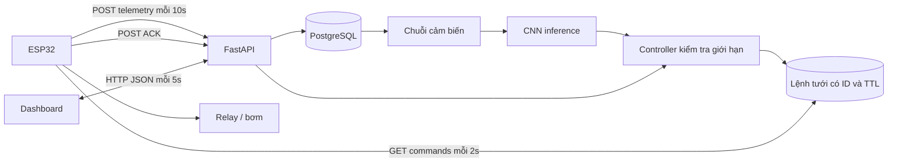

# Giao thức API và lưu trữ

## Kiến trúc



HTTP được chọn vì đủ cho một thiết bị trong LAN, dễ debug và khớp kế hoạch HTTP. MQTT là phương án thay thế trong đề bài, chưa triển khai song song để tránh hai đường lệnh điều khiển không nhất quán.

## Xác thực

Endpoint dashboard: `Authorization: Bearer <ADMIN_TOKEN>`. Endpoint thiết bị: `X-Device-Key: <DEVICE_KEY>`. Hai khóa độc lập, so sánh constant-time. API chỉ nhận `DEVICE_ID` cấu hình. Chưa có quản lý nhiều người dùng hoặc nhiều zone. Không lưu khóa trong JS, Git hay localStorage. Health và giao diện tĩnh không cần khóa; dữ liệu cảm biến và thao tác điều khiển cần khóa.

## Telemetry

`POST /api/telemetry`:

```json
{
  "device_id": "garden-01",
  "sample_id": "boot123-45",
  "timestamp": "2026-10-18T01:00:00Z",
  "soil_moisture": 28.5,
  "temperature": 29.2,
  "humidity": 65.0,
  "light_intensity": 420.0,
  "pump_on": false,
  "sensor_ok": true,
  "reservoir_ok": true,
  "simulated": false
}
```

Ví dụ chỉ minh họa schema; timestamp khi gửi phải là thời gian hiện tại. Đơn vị đất %, nhiệt độ °C, không khí %, BH1750 lux. Backend chấp nhận timestamp ISO có timezone, không cũ hơn 120 giây hoặc vượt tương lai 10 giây. Để bật bơm, cả thời gian đo và thời gian nhận phải mới trong `STALE_SECONDS` (60 giây mặc định). Bản ghi đến sai thứ tự trả 409. `(device_id,sample_id)` duy nhất; gửi lại cùng ID trả `duplicate=true` và không tạo thêm quyết định.

Nếu cảm biến lỗi, gửi `sensor_ok=false`, giá trị hỏng bỏ qua/null. Backend lưu sự kiện lỗi và yêu cầu dừng. Không gửi NaN/Infinity; schema từ chối. Float switch chưa lắp phải được ghi rõ trong hồ sơ phần cứng; `reservoir_ok=true` khi ấy không phải số đo nước.

## Nhận lệnh và ACK

`GET /api/device/commands?device_id=garden-01` trả `{"command":null}` hoặc:

```json
{
  "command": {
    "id": "16de3aae-0c36-4c8b-9667-7d6755296ccd",
    "action": "start",
    "duration_seconds": 5,
    "expires_at": "2026-10-18T01:00:15+00:00"
  }
}
```

Phản hồi thực tế có thêm metadata lệnh. `start` chỉ có hiệu lực 15 giây để giao; firmware phải kiểm tra hết hạn và không chạy lại ID đã xử lý. Server có thể gửi lại lệnh `delivered` khi ACK bị mất. Firmware lưu last ID vào NVS trước relay. Chỉ một lệnh tưới đang hoạt động được tạo dưới khóa hàng `SELECT FOR UPDATE` trên device; không dựa vào mutex riêng trong một process.

`POST /api/device/commands/{id}/ack`:

```json
{"device_id":"garden-01","status":"completed","reason":"Pulse completed","actual_duration_seconds":5.0}
```

Các trạng thái ACK: `started`, `completed`, `rejected`, `stopped`. `completed` cần đã `started`; `started` cần đã `delivered` và chưa hết hạn. ACK lặp idempotent. Lệnh đã kết thúc/hủy không được khôi phục về started. Lệnh stop được ưu tiên và hủy các start đang chờ/đang chạy trong DB; xác nhận thực tế vẫn do thiết bị.

Các trạng thái lịch sử: `queued`, `delivered`, `started`, `completed`, `stopped`, `rejected`, `cancelled`, `timed_out`. Timeout được cập nhật khi có request status/poll/telemetry, không phải timer an toàn vật lý. Timer vật lý nằm ở ESP32, hoạt động ngay cả khi backend ngừng.

## Endpoint dashboard

| Phương thức | Đường dẫn | Chức năng |
|---|---|---|
| GET | `/api/status?device_id=garden-01` | Latest, online, mode, pump, prediction, model, safety |
| GET | `/api/readings?hours=24&limit=5000` | Lịch sử có giới hạn, trả tăng dần theo timestamp |
| GET | `/api/irrigations?limit=50` | Lệnh và ACK mới nhất |
| POST | `/api/mode` | `{device_id,mode: manual/rule/ai}`; đổi mode tạo stop |
| POST | `/api/pump` | `{device_id,action:start/stop,duration_seconds:5}` |
| GET | `/api/export?hours=24` | CSV cảm biến, gồm pump_on và simulated |
| GET | `/health` | Kiểm tra kết nối DB |

Lệnh start thủ công cần mode manual, cảm biến khỏe/mới, đất dưới ngưỡng dừng, còn nước, không bơm/lệnh đang chạy và hết cooldown. Stop luôn có thể yêu cầu cho thiết bị hợp lệ. `pump_state=null` khi thiết bị quá hạn telemetry; UI phải hiển thị chưa rõ, không tự khẳng định bơm tắt.

## Database

`devices`: mode, last_seen, last_water và prediction JSON. `readings`: timestamp, received_at, cảm biến, pump_on, cờ chất lượng và simulated. `commands`: action, thời lượng yêu cầu, thời lượng ACK, nguồn, lý do, lifecycle timestamps. Có foreign key và index `(device_id,timestamp)`/`(device_id,created_at)`, unique sample ID. Thời gian dùng UTC trong database, UI hiển thị Asia/Ho_Chi_Minh.

PostgreSQL được chọn để hỗ trợ truy cập đồng thời và khóa hàng trong các giao dịch tạo lệnh. SQLite đủ cho bài demo nhỏ, dễ cài nhưng không có cùng hành vi khóa hàng; vì người dùng ưu tiên PostgreSQL khi chức năng tương đương, bản triển khai dùng PostgreSQL. Nguồn: [PostgreSQL concurrency control](https://www.postgresql.org/docs/current/mvcc.html).

Schema MVP được tạo bằng `Base.metadata.create_all` lúc startup. Thao tác này không tự migrate một schema cũ đã thay đổi cột. Khi nâng cấp dự án sau bàn giao, tạo migration có phiên bản (ví dụ Alembic), sao lưu trước khi áp dụng. Không xóa DB thật để xử lý nâng cấp schema.
