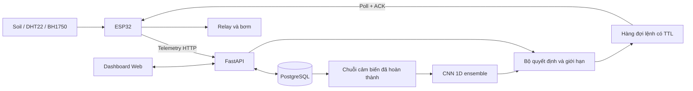

# ĐỒ ÁN SMART GARDEN ỨNG DỤNG IoT VÀ AI

**Bản bàn giao phần mềm ngày 18/10/2026.** Nhóm gồm 3 vai trò: Hardware/Firmware, AI/Data, Backend/Web. Tên thành viên, lớp, giảng viên và thông tin trường do nhóm bổ sung theo hồ sơ thực tế.

## Tóm tắt

Đồ án xây dựng hệ thống một chậu cây: ESP32 đọc độ ẩm đất, nhiệt độ, độ ẩm không khí và ánh sáng; gửi dữ liệu qua Wi-Fi/HTTP đến FastAPI; PostgreSQL lưu lịch sử; dashboard cho phép giám sát, tưới thủ công và chọn điều khiển theo ngưỡng hoặc AI. Lệnh tưới có định danh, hạn sử dụng, xác nhận thực thi và giới hạn thời gian trên thiết bị. CNN 1D dùng chuỗi cảm biến quá khứ để dự báo hành vi tưới kỳ kế tiếp; ba mô hình truyền thống làm đối chứng.

CNN được huấn luyện thực tế bằng NVIDIA GeForce RTX 2050. Trên tập test theo thời gian gồm 184 cửa sổ, 4 nhãn dương, CNN đạt F1 0,5455 và recall 0,75. Kết quả cho thấy pipeline hoạt động nhưng chưa đủ chứng minh tưới tối ưu. Dataset công khai không có nhãn thời lượng, nên hệ thống phân biệt rõ dự báo WATER/NO WATER với xung tưới cấu hình. Nhánh hồi quy thời gian đã được lập trình để sử dụng khi có nhãn thực nghiệm độc lập.

## 1. Bài toán, mục tiêu và phạm vi

Tưới định kỳ cố định không phản ánh trực tiếp độ ẩm hiện tại; điều khiển thủ công cũng khó ghi nhận lịch sử đầy đủ. Hệ thống cần đo môi trường, đưa ra quyết định có thể giải thích, điều khiển bơm từ xa và lưu bằng chứng của từng lần tưới.

Mục tiêu kỹ thuật là triển khai chuỗi cảm biến → truyền dữ liệu → lưu trữ → dự đoán → lệnh → chấp hành → phản hồi. Mục tiêu nghiên cứu là so sánh CNN với Logistic Regression, Decision Tree, Random Forest và rule trên cùng cách chia dữ liệu, đồng thời nhận diện giới hạn nhãn và sai khác môi trường.

Phạm vi hiện tại là một ESP32, một chậu, một bơm DC điện áp thấp và máy tính làm server trong LAN. Chọn HTTP đáp ứng lựa chọn HTTP/MQTT của đề bài; không cần triển khai đồng thời hai giao thức. Không có camera, nhiều vùng tưới, ứng dụng điện thoại riêng hoặc cảm biến lưu lượng trong bản core.

Yêu cầu trực tiếp của người dùng được ưu tiên khi khác kế hoạch cũ: dùng PostgreSQL, bổ sung CNN và train GPU. Ba baseline trong tài liệu gốc vẫn được giữ để đối chứng. Chi tiết đối chiếu ở [KE_HOACH.md](KE_HOACH.md).

## 2. Cơ sở và kiến trúc

IoT nối các cảm biến và thiết bị chấp hành với dịch vụ thu thập, lưu trữ, giám sát. Trong bản này, AIoT bổ sung mô hình học từ chuỗi cảm biến vào quá trình hỗ trợ quyết định. ESP32 chịu trách nhiệm đo và chấp hành cục bộ; server chịu trách nhiệm lịch sử, xác thực, mô hình và điều phối. Mất server không được làm mất giới hạn tắt bơm trên ESP32.

Telemetry có ID mẫu, thời gian UTC, ID thiết bị, bốn đặc trưng môi trường, trạng thái cảm biến, bình nước, bơm và cờ mô phỏng. Backend kiểm tra miền giá trị và độ mới; ID trùng không sinh thêm hành động. Web cập nhật mỗi 5 giây; ESP32 gửi khoảng 10 giây, tùy độ trễ mạng. Đây là cập nhật gần thời gian thực qua polling.

## 3. Thiết kế phần cứng

ESP32 DevKit dùng ADC1 GPIO34 cho cảm biến đất điện dung, GPIO4 cho DHT22, GPIO21/22 cho BH1750 và GPIO26 cho relay. Công tắc phao tùy chọn dùng GPIO27. Bơm dùng nguồn riêng, tiếp điểm thường mở, và module điều khiển tương thích logic 3,3V. Sơ đồ, hiệu chuẩn, điều kiện cấp nguồn và quy trình kiểm tra ở [HARDWARE.md](HARDWARE.md).

Độ ẩm đất quy đổi theo hai mốc ADC khô/ướt: `soil = clip(100 × (dry − raw)/(dry − wet), 0, 100)`. Đây là phần trăm tương đối của cấu hình hiệu chuẩn. Cần giữ nhất quán loại đất, vị trí đầu dò và cảm biến; không đồng nhất nó với phần trăm nước thể tích chuẩn đo lường.

Firmware có task FreeRTOS riêng điều khiển relay. Task kiểm tra thời lượng, độ mới cảm biến, liên lạc, ngưỡng đủ ẩm và công tắc phao nếu bật. ID lệnh gần nhất được ghi NVS trước khi chạy để hạn chế phát lại sau reset. Firmware đã biên dịch; chưa có bo mạch nối với môi trường kiểm tra để xác nhận hành vi điện thực tế.

## 4. PostgreSQL hay SQLite?

SQLite có lợi thế cài đặt nhẹ và phù hợp một ứng dụng ghi ít dữ liệu. PostgreSQL cần dịch vụ riêng nhưng phù hợp khi telemetry, dashboard và nhiều yêu cầu điều khiển cùng truy cập. Đồ án sử dụng transaction và khóa hàng thiết bị để tuần tự hóa các lệnh bật bơm; điều này đã được kiểm thử trên PostgreSQL với bốn yêu cầu đồng thời và chỉ một lệnh được chấp nhận.

Vì người dùng ưu tiên PostgreSQL và máy có sẵn PostgreSQL, chọn **PostgreSQL làm database triển khai**. SQLite chỉ là phương án chạy unit test nhanh, không dùng để chứng minh khóa hàng hoặc khả năng đồng thời của PostgreSQL. Cluster riêng cổng 55432 không thay đổi dịch vụ PostgreSQL khác của máy.

Ba bảng chính:

| Bảng | Dữ liệu | Vai trò |
|---|---|---|
| Device | ID, chế độ, lần liên lạc, lần tưới, quyết định gần nhất | Trạng thái và điểm khóa giao dịch |
| Reading | ID mẫu, timestamp, cảm biến, cờ trạng thái, simulated | Lịch sử đầu vào và xuất dataset |
| Command | ID, action, duration, source, TTL, trạng thái, ACK | Theo dõi ý định và xác nhận lệnh |

Schema chi tiết nằm trong `backend/db.py`. Bản đồ án tạo bảng khi khởi động; thay schema trên database đã có dữ liệu cần bổ sung migration có quản lý. Không xóa dữ liệu để nâng cấp một triển khai đang dùng.

## 5. API, dashboard và điều khiển

API tách khóa thiết bị và khóa quản trị. Telemetry và nhận lệnh dùng `X-Device-Key`; xem lịch sử, đổi mode và điều khiển dùng Bearer token. Khóa trong `.env`, không hard-code trong web hoặc đưa lên Git. HTTP ở đây phục vụ LAN; mở Internet cần lớp HTTPS và quản lý tài khoản phù hợp.

Dashboard tiếng Việt hiển thị bốn chỉ số, biểu đồ lịch sử, trạng thái liên lạc, trạng thái relay, nguồn quyết định, xác suất AI, thời lượng và lịch sử lệnh. Có nút xuất CSV và nhãn rõ khi chạy mô phỏng. Trạng thái ngoại tuyến không bị diễn giải là bơm đã tắt. ACK chỉ xác nhận quá trình thực hiện; `pump_on` là trạng thái điều khiển relay, chưa chứng minh nước đang chảy.

Ba chế độ:

| Chế độ | Quyết định | Điều kiện |
|---|---|---|
| Manual | Người dùng yêu cầu một xung | Kiểm tra cảm biến, dữ liệu mới, thời lượng và cooldown |
| Rule | Tưới khi đất dưới ngưỡng bắt đầu | Dừng ở ngưỡng đủ ẩm; lệnh đang chạy ngăn bật lặp |
| AI | CNN nếu đủ lịch sử và được phép | Khi lỗi/thiếu dữ liệu/khóa thử nghiệm thì dùng ngưỡng dự phòng |

Mặc định xung 5 giây, trần 30 giây, nghỉ 300 giây, bắt đầu dưới 30%, dừng từ 60%. Đây là giá trị demo cần hiệu chuẩn. Mỗi lệnh có TTL 15 giây; lệnh hết hạn không được giao để khởi động. Đổi mode gửi lệnh dừng; lệnh dừng ưu tiên và hủy các lệnh bật còn hiệu lực. Kiểm tra trên ESP32 vẫn hoạt động độc lập khi HTTP đang chờ.

Model công khai mang cờ thử nghiệm, mặc định chưa được cho phép tự điều khiển. Tích hợp AI đã có; việc cho phép tưới thực tế cần đánh giá dữ liệu của chậu. Không đổi ngưỡng dự báo để ép demo luôn hiện WATER.

## 6. Dữ liệu, CNN và đánh giá

Nguồn là [Mendeley Data, DOI 10.17632/jtsyb593fy.1](https://data.mendeley.com/datasets/jtsyb593fy/1), 960 mẫu/20 ngày/30 phút. Bản gốc và hash nằm trong `data/raw`. Dataset có 28 dòng bơm bật; nhãn là trạng thái bơm lịch sử, chưa phải nhu cầu tối ưu. Cột ánh sáng của nguồn chưa được xác nhận tương đương lux như BH1750; múi giờ nguồn cũng chưa được xác nhận. Các khác biệt này cần kiểm chứng khi chuyển sang cây thật.

Đầu vào CNN là 4 đặc trưng × 8 mốc quá khứ; cảm biến ở dòng nhãn không được đưa vào đầu vào vì có thể đã chịu tác động của tưới. Tách dòng theo thời gian 60/20/20 trước khi tạo cửa sổ; median và chuẩn hóa chỉ fit trên train. Mỗi tập tạo 568/184/184 cửa sổ, không dùng chung dòng giữa các tập. Cửa sổ qua khoảng trống bị loại.

Mạng gồm Conv1D, GELU, dropout, convolution giãn cách, pooling và hai head. Classification dùng BCE có trọng số lớp; regression dùng SmoothL1 khi có nhãn thời lượng. Chạy 3 cấu hình × 3 seed với AdamW, early stopping, scheduler và gradient clipping. Chọn cấu hình bằng validation, ensemble ba seed, chọn threshold bằng F1 validation. Test được dành cho đánh giá cuối. Thiết bị train là RTX 2050, PyTorch 2.8.0+cu126; inference dùng CPU.

| Mô hình | Precision | Recall | F1 | Average precision |
|---|---:|---:|---:|---:|
| CNN 1D | 0,4286 | 0,7500 | 0,5455 | 0,6778 |
| Logistic Regression | 1,0000 | 0,5000 | 0,6667 | 0,6117 |
| Decision Tree | 0,5000 | 1,0000 | 0,6667 | 0,5000 |
| Random Forest | 0,5000 | 0,2500 | 0,3333 | 0,6917 |
| Rule dưới 30% | 0 | 0 | 0 | 0,0217 |

CNN đúng 3/4 mẫu WATER, bỏ sót 1 và báo WATER nhầm 4 mẫu. CNN không thắng mọi baseline; các sự kiện dương quá ít nên chưa thể kết luận ưu thế ổn định. Accuracy cao ở bài toán mất cân bằng không đủ bằng chứng: luôn NO WATER cũng đạt 97,83% nhưng F1=0. Chi tiết thuật toán, confusion matrix, learning curves và giới hạn tại [AI.md](AI.md).

Không có nhãn duration trong dữ liệu công khai, vì vậy chưa có MAE/RMSE/R² thời lượng được đo. Nhánh hồi quy chỉ hoạt động sau khi train bằng `water_needed` và `duration_seconds` có căn cứ độc lập. Cách thu thập, ghép nhãn, lọc mô phỏng và train lại ở [EXPERIMENT.md](EXPERIMENT.md). Không dùng số giây do chính hệ thống chọn làm bằng chứng nó đã học thời gian tưới tối ưu.

## 7. Kiểm thử và bằng chứng

Kiểm thử API gồm xác thực, dữ liệu ngoài miền, timestamp sai, mẫu trùng, lệnh hết hạn, chuyển mode, cooldown, sensor lỗi, nguồn dữ liệu cũ và nhiều yêu cầu bật bơm đồng thời. Kiểm thử ML kiểm tra chia tập trước tạo cửa sổ, scaler chỉ học train, không dùng dòng nhãn, loại khoảng trống, lỗi checkpoint, loại dữ liệu mô phỏng và khớp xác suất inference với checkpoint đã đánh giá.

Firmware build thành công cho esp32dev: RAM 47.816 byte, Flash 939.769 byte. Demo phần mềm đã chạy qua trình duyệt và thiết bị giả lập, lưu PostgreSQL và xác nhận chu trình lệnh tưới. Ảnh giao diện và bản ghi kiểm chứng nằm trong [VERIFICATION.md](VERIFICATION.md). Các kiểm tra này không thay thế thử GPIO, relay, bơm, mất Wi-Fi và hiệu chuẩn thực tế.

## 8. Kết luận và công việc thực nghiệm còn lại

Phần mềm bàn giao gồm firmware, API/PostgreSQL, dashboard, bộ giả lập, pipeline CNN GPU, checkpoint, baseline và tài liệu tái lập. Kiến trúc đã tách dự đoán khỏi giới hạn điều khiển, lưu lịch sử lệnh và thể hiện rõ dữ liệu mô phỏng. Kết quả AI được báo cáo theo những gì đo được, có đối chứng và có giới hạn nhãn.

Để nghiệm thu toàn bộ đồ án phần cứng, nhóm cần nạp firmware, hiệu chuẩn cảm biến/lưu lượng, kiểm tra các cơ chế dừng trên bo thật, thu dữ liệu nhiều chu kỳ tưới, gán nhãn thời lượng độc lập, train/đánh giá hồi quy và quay video demo thực tế. Chưa có dữ liệu để kết luận tiết kiệm nước, nâng cao sức khỏe cây hoặc thời gian tưới tối ưu.

## Tài liệu và đầu mối tái lập

- Hai tài liệu gốc được lưu trong `docs/references/`; đối chiếu nội dung tại [KE_HOACH.md](KE_HOACH.md).
- [Dataset Mendeley và thông tin tác giả/giấy phép](https://data.mendeley.com/datasets/jtsyb593fy/1).
- [Hướng dẫn chạy](../README.md), [API và kiến trúc](API.md), [phần cứng](HARDWARE.md).
- [Quy trình AI](AI.md), [quy trình thực nghiệm](EXPERIMENT.md), [kịch bản demo](DEMO.md).
- `models/current/metadata.json`, `metrics.json`, `search.json`, `test_predictions.csv`: cấu hình và kết quả máy đọc được.
