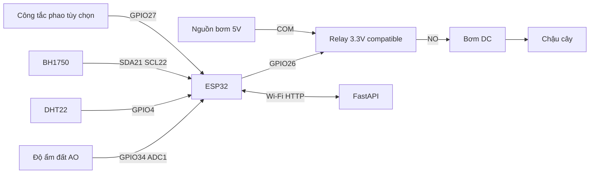

# Phần cứng và firmware Smart Garden

Mô hình một chậu cây sử dụng ESP32 DevKit, cảm biến đất điện dung, DHT22, BH1750, relay và bơm DC 5V. Firmware nằm trong `firmware/src/main.cpp`. Các giá trị hiệu chuẩn trong tệp mẫu chỉ là điểm khởi đầu, cần đo trên linh kiện thực tế.

## Nối dây

| Thiết bị | Chân | ESP32 / nguồn |
|---|---|---|
| Soil capacitive V1.2 | VCC / GND / AO | 3V3 / GND / GPIO34 (ADC1) |
| DHT22 | VCC / GND / DATA | 3V3 / GND / GPIO4 |
| DHT22 rời | DATA kéo lên | Điện trở 4,7–10 kΩ lên 3V3 nếu module chưa có |
| BH1750 | VCC / GND / SDA / SCL | 3V3 / GND / GPIO21 / GPIO22 |
| Relay tương thích logic 3,3V | IN | GPIO26 |
| Relay | VCC | Theo thông số module, thường 5V; không cấp coil từ GPIO |
| Relay | COM | Dương nguồn 5V riêng cho bơm |
| Relay | NO | Dương bơm |
| Bơm | Âm | Âm nguồn bơm |
| Float switch tùy chọn | Signal / GND | GPIO27 / GND; LOW = còn nước |

ESP32 cấp qua USB. Bơm lấy nguồn riêng đủ dòng. Mạch logic module relay cần GND tham chiếu phù hợp với sơ đồ của module; loại có cách ly JD-VCC phải đấu theo tài liệu module. Không đưa 5V vào ADC hoặc GPIO ESP32. Kiểm tra relay active LOW/HIGH bằng LED hoặc đồng hồ trước khi gắn bơm. Dùng tiếp điểm NO để mất nguồn điều khiển thì bơm tắt. Thêm diode dập xung ngược đúng chiều song song bơm DC nếu mạch điều khiển chưa có bảo vệ phù hợp. Đồ án dùng điện áp thấp, không dùng điện lưới cho phần thực hành.



GPIO34 thuộc ADC1 nên đọc được khi Wi-Fi hoạt động. Đặt phần điện tử cảm biến đất ở trên mặt đất, tránh ngâm phần mạch. BH1750 trả lux; không thay bằng ADC của LDR mà giữ nguyên đơn vị.

## Hiệu chuẩn

1. Ngắt nguồn bơm. Mở Serial Monitor 115200.
2. Đo ADC ở đất khô phù hợp với thí nghiệm, ghi ít nhất 30 mẫu, lấy trung vị làm `SOIL_DRY_ADC`.
3. Đo ở đất đủ ướt sau khi thoát nước dư; lấy trung vị làm `SOIL_WET_ADC`.
4. Kiểm tra dry > wet. Công thức `100 × (dry - raw)/(dry - wet)`, giới hạn [0,100]. Đây là độ ẩm tương đối theo hiệu chuẩn của chậu, không phải phép đo phần trăm thể tích nước được chứng nhận.
5. Ghi loại đất, chậu, cây, vị trí đầu dò và hai mốc ADC vào sổ thực nghiệm. Hiệu chuẩn lại khi đổi cảm biến hoặc đất.
6. Với bơm, đo thể tích nước trong 5 giây ít nhất 3 lần. Đặt `DEFAULT_PUMP_SECONDS` theo kết quả trên chậu; bắt đầu ngắn, chờ nước thấm. Giới hạn 30 giây là trần phần mềm, không phải thời lượng được khuyến nghị cho mọi chậu.

## Nạp và kiểm tra

Sao chép `garden_config.example.h` → `garden_config.h`, điền Wi-Fi 2,4GHz, địa chỉ LAN của laptop và khóa thiết bị. Không ghi `ADMIN_TOKEN` vào firmware. Nếu không tạo tệp riêng, firmware vẫn biên dịch bằng cấu hình mẫu nhưng không kết nối được mạng thật.

```powershell
$env:PLATFORMIO_CORE_DIR = "$PWD\runtime\platformio"
.\.venv\Scripts\python.exe -m platformio run -d firmware
.\.venv\Scripts\python.exe -m platformio run -d firmware -t upload
.\.venv\Scripts\python.exe -m platformio device monitor -d firmware
```

Có thể thêm `--upload-port COMx` và `--port COMx` nếu nhiều cổng serial. Cần driver USB phù hợp CH340/CP2102. Firmware đồng bộ NTP về UTC; khi chưa có giờ hợp lệ, không gửi timestamp tự chế và không nhận lệnh bật bơm.

## Chu kỳ hoạt động

- Đọc cảm biến khoảng 2,5 giây; lấy trung bình 16 lần ADC để giảm nhiễu.
- Gửi telemetry khoảng 10 giây, poll lệnh khoảng 2 giây; khoảng thời gian thực tế có thể tăng do độ trễ mạng.
- HTTP có timeout hữu hạn. Task an toàn FreeRTOS chạy mỗi 20 ms và sở hữu chân relay, độc lập với vòng HTTP.
- Một xung tối đa 30 giây. Tắt khi cảm biến không hợp lệ/quá cũ, đất đạt ngưỡng dừng, hết nước nếu gắn phao, hoặc mất liên lạc quá 10 giây.
- Lưu ID lệnh vào NVS trước khi bật. Không chạy lại một xung đã xử lý sau reboot hoặc khi server gửi lại lệnh.
- Firmware gửi `started` trước khi task cho phép bật; task vẫn có thể từ chối theo điều kiện cục bộ. Vì vậy dashboard dùng telemetry `pump_on` để hiển thị trạng thái chân relay, không suy ra từ ACK.

Nếu chưa gắn phao, `USE_RESERVOIR_SWITCH=false`; hệ thống **không đo được bình cạn**. `pump_on` thể hiện trạng thái điều khiển relay, không chứng minh có nước chảy. Muốn phát hiện bơm kẹt/ống tắc cần cảm biến lưu lượng; đó là nâng cấp, chưa triển khai.

## Nghiệm thu trên bàn và cây thật

Thực hiện lần lượt: kiểm tra mức relay khi boot; đọc từng cảm biến; tưới 1–3 giây có giám sát; gửi lại cùng ID; ngắt Wi-Fi khi bơm chạy; rút DHT22; đưa đất vượt ngưỡng; thử phao; reset ESP32 trong lúc bơm bật. Ghi thời điểm tắt thực đo, không chỉ dựa vào log phần mềm. Sau khi đạt mới chạy theo dõi nhiều ngày trên cây.

Phiên bản đã biên dịch thành công cho `esp32dev`: RAM 47.816 byte (14,6%), Flash 939.769 byte (71,7%). Đây là kiểm tra biên dịch, chưa phải xác nhận điện/mạch hay đo thời gian trên bo thật.
