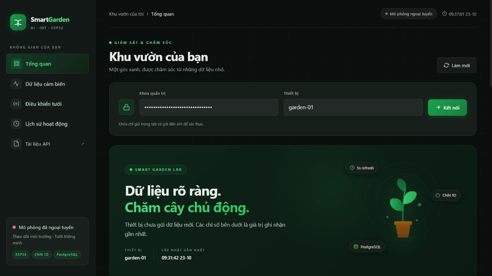

# Kiểm tra giao diện ngày 23 tháng 10 năm 2026

Hoàn thiện bộ giao diện nền tối đang sửa trong `web/`, giữ API và mô hình hiện có. Phần review chạy trên cổng 8001 với database PostgreSQL tạm riêng và khóa review riêng; tất cả số đo và lệnh tưới trong lần review là mô phỏng, không điều khiển thiết bị vật lý.

## Những phần đã hoàn thiện

- Bố cục desktop và mobile, thẻ cảm biến, biểu đồ, thẻ dự báo, điều khiển và nhật ký.
- Chữ tiếng Việt, độ tương phản, hỗ trợ bàn phím, giảm chuyển động theo cài đặt người dùng; dùng font hệ thống để chạy trong LAN không cần tải Google Fonts.
- Menu mobile có lớp nền, đóng bằng Escape hoặc chọn mục, giữ focus trong menu; trạng thái mục điều hướng theo liên kết đang chọn.
- Bảng lịch sử giữ cấu trúc bảng và cuộn ngang trên màn hình hẹp; trạng thái trống/ẩn không đè lên biểu đồ.
- Không bật lại nút tưới trong lúc gửi yêu cầu hoặc còn lệnh start đang hoạt động; khóa tưới khi offline, cảm biến lỗi hoặc đất đạt ngưỡng dừng. Server vẫn là nơi kiểm tra giới hạn và cooldown cuối cùng.
- Trạng thái mô phỏng ngoại tuyến nhất quán ở sidebar và thanh trên. Khi offline, ẩn gợi ý và thời lượng cũ, hiển thị bơm chưa rõ.
- Báo lỗi kết nối/khóa và timeout bằng tiếng Việt; không giữ token trong localStorage hoặc sessionStorage. Token được gửi đến API để xác thực, đúng với mô tả trên form.

## Các kiểm tra đã thực hiện

| Ca kiểm tra | Kết quả |
|---|---|
| Chưa nhập khóa | Chỉ số trống, thao tác cần dữ liệu bị khóa |
| Khóa sai | Có thông báo khóa không hợp lệ; không bật bơm |
| Kết nối đúng | Số đo, biểu đồ và lịch sử tải được từ PostgreSQL review |
| Nhập 31 giây | Giao diện chặn vì vượt trần 30 giây |
| Tưới thủ công 3 giây | Lệnh được gửi; nút start bị khóa; lịch sử nhận started rồi completed từ simulator |
| Chuyển AI | Có lệnh stop khi đổi mode; hiện nguồn Ngưỡng dự phòng và lý do thiếu 8 mốc 30 phút |
| Giới hạn thời gian nghỉ | Hiển thị lý do chờ nước thấm từ API |
| Trở về thủ công | Chọn mode và áp dụng được bằng bàn phím; ghi nhận lệnh dừng |
| Đổi cảm biến và khoảng thời gian | Biểu đồ, nhãn và trạng thái chọn cập nhật |
| Xuất CSV | Tệp tải được từ nút giao diện |
| Ngoại tuyến | Sidebar/topbar nhất quán, start bị khóa, bơm chưa rõ, gợi ý cũ bị ẩn |
| Menu mobile | Mở, chọn mục, Escape và aria-expanded hoạt động |
| Responsive | Kiểm tra 320×740, 390×844, 768×1024 và viewport desktop mặc định; không tràn ngang toàn trang, bảng có vùng cuộn riêng |
| Cấu trúc DOM | Không có ID trùng |
| JavaScript | `node --check web/app.js` đạt |
| Khoảng trắng diff | `git diff --check -- web` đạt |
| Kiểm thử API/AI với PostgreSQL | **30 passed** trong 18,17 giây; một cảnh báo deprecation từ Starlette/TestClient |

Trong phiên có thời điểm máy chủ review phản hồi chậm và simulator gặp ReadTimeout. UI chuyển sang trạng thái mất kết nối và khóa start; kiểm tra sau đó xác nhận `/health` trả 200 và giao diện kết nối lại được. Phiên này xác nhận các thao tác và trạng thái phần mềm nêu trên, chưa phải đánh giá tải dài hạn hay kiểm thử relay/cảm biến/bơm thật.

Các tài liệu và ảnh demo cũ mô tả phiên bàn giao ban đầu. Xem ảnh và ghi chú tại đây để đối chiếu UI mới. Không dùng ảnh mô phỏng làm bằng chứng thí nghiệm cây thật.
