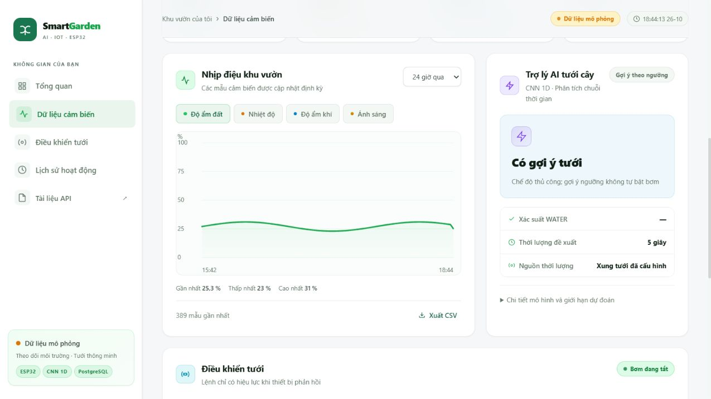
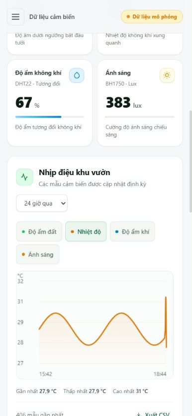

# Kiểm tra giao diện sáng — 26/10/2026

## Phạm vi hoàn thiện

- Tiếp tục giao diện trắng, xanh lá đang chỉnh sửa: thống nhất chữ, màu, khoảng cách, thẻ cảm biến, thanh điều hướng và nút thao tác.
- Dùng phông hệ thống, bỏ tải Google Fonts và giảm hiệu ứng trang trí để tập trung vào dữ liệu.
- Biểu đồ có giá trị gần nhất, thấp nhất, cao nhất; không nối đường qua khoảng trống quá hai phút hoặc khi đổi nguồn mô phỏng. Loại mẫu cảm biến lỗi khỏi đường biểu diễn.
- Khối AI phân biệt gợi ý theo ngưỡng với CNN; phần giới hạn mô hình có thể mở để đọc.
- Giữ lựa chọn chế độ chưa áp dụng khi trang tự cập nhật. Hiển thị lý do khóa tưới và đếm ngược thời gian chờ nước thấm.
- Thông báo có nút đóng, không làm dịch chuyển bố cục. Hỗ trợ bàn phím và giảm chuyển động theo cài đặt hệ thống.

## Kết quả kiểm tra

- Cú pháp JavaScript: `node --check web/app.js` đạt.
- Khoảng trắng bản thay đổi: `git diff --check` đạt.
- Kiểm thử API, dữ liệu và AI với PostgreSQL: **30 passed**. Có một cảnh báo thư viện Starlette/TestClient; không có kiểm thử thất bại.
- Kiểm tra bằng trình duyệt tại 320, 390, 768 và 1280 px: chiều rộng nội dung không vượt màn hình. Bảng lịch sử giữ vùng cuộn riêng.
- Menu điện thoại: mở, chọn mục tự đóng; Escape đóng menu và trả tiêu điểm về nút mở.
- Kết nối API, chuyển cảm biến, cập nhật thống kê, mở/đóng chi tiết mô hình và đọc trạng thái hoạt động: đạt. Không ghi nhận lỗi hoặc cảnh báo console trong phiên kiểm tra.
- Chọn chế độ rồi làm mới không làm mất lựa chọn chưa áp dụng. Thời lượng 31 giây bị chặn; lệnh mô phỏng 3 giây được xác nhận hoàn thành và nút tưới chuyển sang thời gian chờ.

## Giới hạn xác minh

Phiên kiểm tra dùng cơ sở dữ liệu PostgreSQL tạm và thiết bị phần mềm mô phỏng, không điều khiển GPIO hay bơm thật. Đây là kiểm tra giao diện và luồng phần mềm; vẫn cần kiểm chứng cảm biến, relay, bơm và hiệu chuẩn trên cây thật.

Ảnh chụp dùng dữ liệu mô phỏng, đã gắn nhãn trên giao diện:

