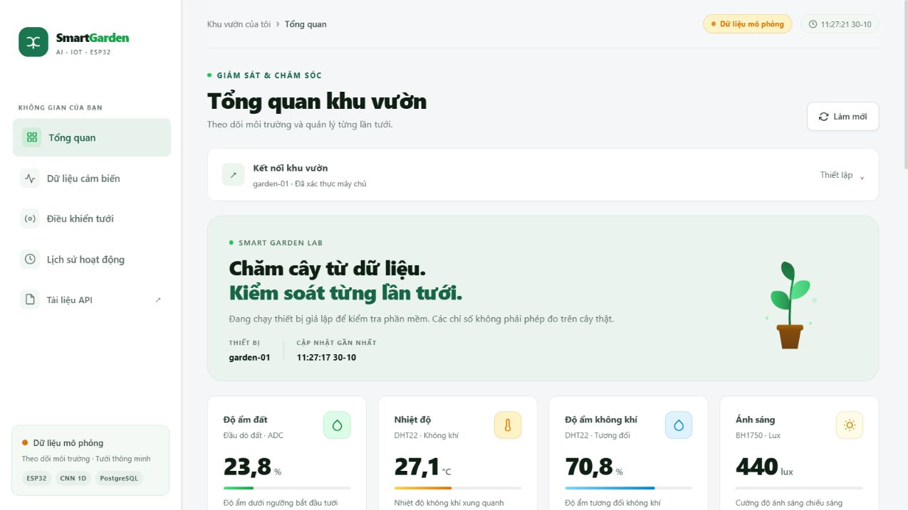
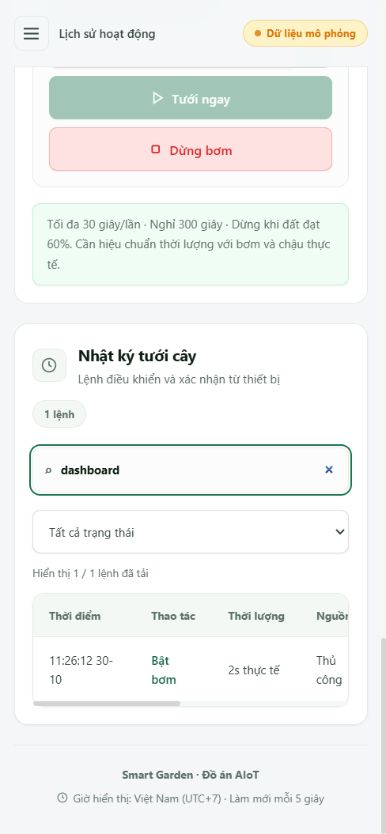

# Hoàn thiện giao diện — 30/10/2026

## Thay đổi

- Đồng bộ thanh điều hướng, màu nền, kiểu chữ, thẻ chỉ số, biểu đồ và bảng nhật ký theo giao diện sáng.
- Thiết lập kết nối tự thu gọn sau lần xác thực thành công đầu tiên trong tab. Có thể mở lại bằng bàn phím hoặc chuột; khóa vẫn chỉ nằm trong bộ nhớ tab.
- Bổ sung tổng quan liên lạc, tuổi bản ghi gần nhất, trạng thái cảm biến/nguồn nước do thiết bị báo và chế độ thực sự đang áp dụng. Khi mất kết nối hoặc trạng thái quá cũ, tổng quan không khẳng định thiết bị sẵn sàng.
- Tìm kiếm nhật ký theo thao tác, nguồn, trạng thái, thời điểm và ghi chú; kết hợp bộ lọc đang xử lý, đã kết thúc, cần kiểm tra. Đếm rõ số kết quả trong các lệnh đã tải, không ngụ ý truy vấn toàn bộ lịch sử.
- Đổi nhãn đầu dò đất sang mô tả chung vì phần cứng có thể dùng cảm biến điện trở hoặc điện dung. Không thay đổi cách hiệu chuẩn hay firmware.

## Xác minh

- `node --check web/app.js` và `git diff --check`: đạt.
- `pytest -q --postgres --basetemp runtime/pytest-ui-20261030 --tb=short --maxfail=1`: **30 passed**, 11,60 giây. Một cảnh báo thư viện Starlette/TestClient, không có kiểm thử thất bại.
- Trình duyệt ở 1280, 768, 390 và 320 px: không tràn ngang toàn trang; bảng giữ vùng cuộn riêng trên điện thoại.
- Khóa sai: hiện lỗi, form vẫn mở, nút tưới bị khóa. Khóa đúng: xác thực, form thu gọn, trạng thái tổng quan được cập nhật.
- Lệnh tưới mô phỏng 2 giây: được xác nhận hoàn thành, thời gian chờ tiếp tục hiển thị.
- Nhật ký: lọc đã kết thúc thấy lệnh hoàn thành; từ khóa không khớp trả 0/1 với hướng dẫn; từ khóa THỦ CÔNG trả lại 1/1; kết hợp bộ lọc cần kiểm tra trả 0/1.
- Chọn chế độ AI nhưng chưa áp dụng rồi làm mới: lựa chọn được giữ, tổng quan vẫn ghi Thủ công đúng với máy chủ.
- Menu điện thoại chọn mục tự đóng; tìm nhật ký hoạt động trên điện thoại. Không ghi nhận lỗi console trong phiên kiểm tra.

Phiên xác minh dùng database tạm riêng, dữ liệu mô phỏng và thiết bị phần mềm, không điều khiển bơm thật. Trạng thái nguồn nước là tín hiệu thiết bị báo, không chứng minh có cảm biến phao hoặc có dòng nước thực tế.

