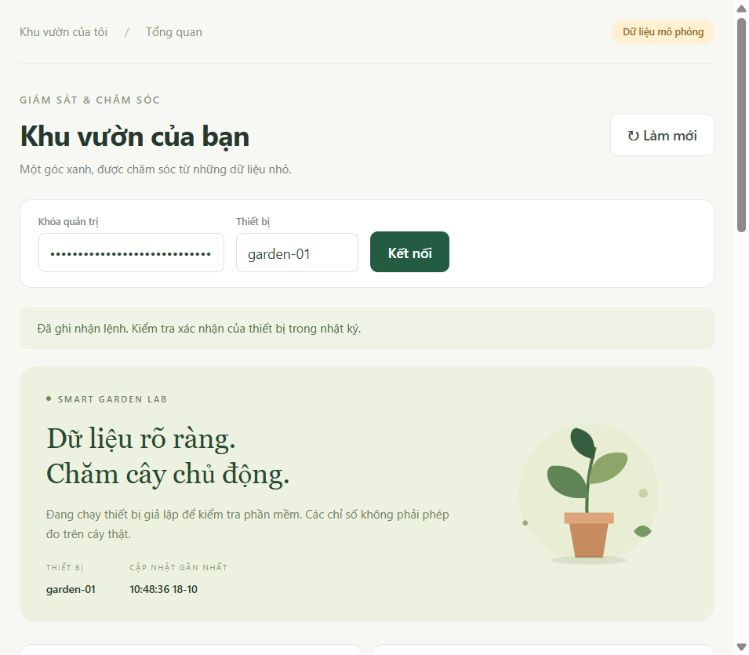
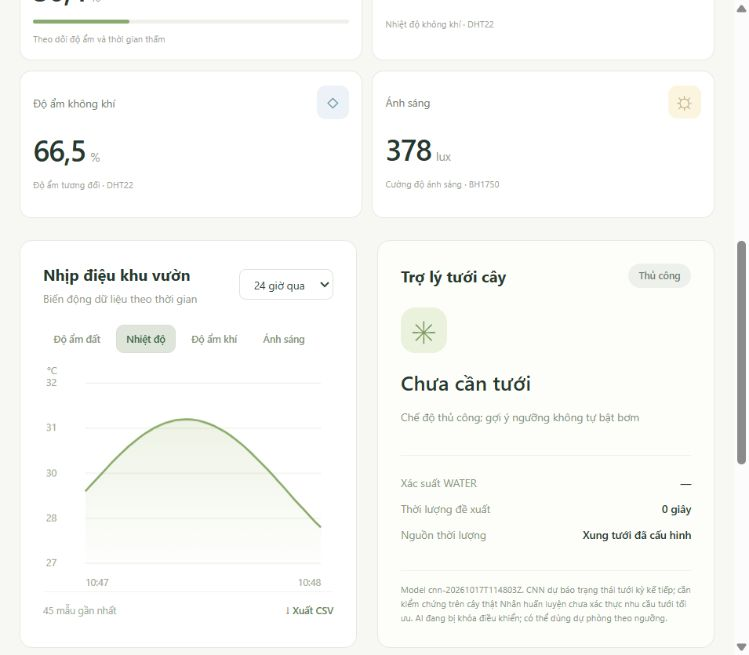
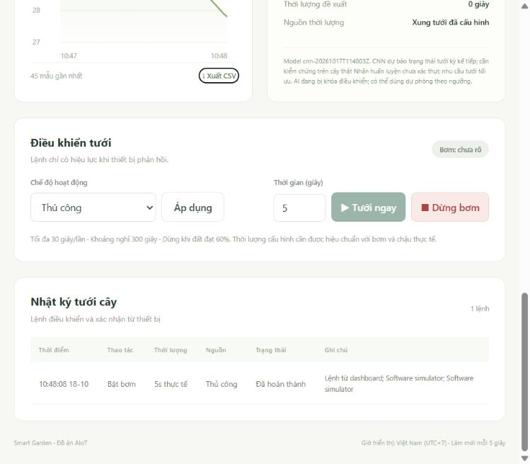

# Kết quả kiểm chứng bản bàn giao

Ngày chốt: **18/10/2026**. Các mục dưới phân biệt kiểm thử phần mềm với thực nghiệm phần cứng.

| Hạng mục | Kết quả | Bằng chứng/giới hạn |
|---|---|---|
| Đọc hai tài liệu DOCX | Đã đọc đoạn văn và bảng | Bản sao nguyên gốc trong `references/`, đối chiếu KE_HOACH.md |
| PostgreSQL 18 | Đã khởi tạo và dùng thực tế | Cluster riêng `runtime/postgres`, cổng 55432 |
| API + ML tests | **30 passed**, 17,66 giây | Chạy với `--postgres`, DB riêng smart_garden_test |
| Đồng thời lệnh bật | Đạt | 4 yêu cầu song song, 1 được chấp nhận, 3 bị chặn |
| CNN thật → API → lệnh | Đạt | Nạp checkpoint hiện tại, dùng cửa sổ test đã lưu; xác suất khớp, nguồn lệnh `cnn` |
| Tách mô phỏng khỏi AI thật | Đạt | Lịch sử mô phỏng cùng bin không thay thế lịch sử thực của kiểm tra |
| Timestamp có/không giây lẻ | Đạt sau sửa | Đọc ISO 8601 nhất quán ở inference và chuẩn bị dữ liệu thực |
| JavaScript | Đạt kiểm tra cú pháp | `node --check web/app.js` |
| Python | Đạt biên dịch cú pháp | compileall cho backend, ml và scripts |
| Firmware ESP32 | Build thành công | RAM 47.816 byte (14,6%); Flash 939.769 byte (71,7%) |
| CNN GPU | Đã train | RTX 2050, PyTorch 2.8.0+cu126; 9 lượt tìm cấu hình/seed |
| Baseline | Đã train và lưu | Logistic Regression, Decision Tree, Random Forest dạng joblib |
| Dashboard trình duyệt | Đã kiểm tra | Kết nối, số đo, đổi biểu đồ, nhật ký, khóa nút tưới khi ngoại tuyến |
| Chu trình tưới mô phỏng | Đã hoàn thành | 45 telemetry simulated; một lệnh 5 giây được xác nhận completed |
| Console giao diện | Không có error/warn trong lần kiểm tra cuối | Kiểm tra phạm vi thao tác demo, không phải chứng nhận mọi trình duyệt |
| Biểu đồ ML | Đã xem ảnh | Learning curves và confusion matrix đọc được, khớp bảng metrics |
| Docker | Chưa chạy | Có Dockerfile/compose; chưa xác nhận bằng Docker daemon |
| Nạp bo/relay/bơm/cây | Chưa thực hiện | Không có thiết bị vật lý kết nối trong phiên làm việc |
| Hồi quy thời gian trên dữ liệu thực | Chưa train | Chưa có ground truth duration; không có metrics hồi quy để báo cáo |

## Tái lập kiểm thử

Từ thư mục Smart_Garden, khởi động PostgreSQL riêng trước rồi chạy:

```powershell
.\.venv\Scripts\python.exe scripts/local_db.py start
.\.venv\Scripts\python.exe -m pytest -q --postgres --basetemp runtime/pytest-check
node --check web/app.js
.\.venv\Scripts\python.exe -m compileall -q backend ml scripts
```

Lần chạy cuối có một **StarletteDeprecationWarning** về tích hợp TestClient/httpx; tất cả 30 kiểm thử vẫn đạt. Đây là cảnh báo phụ thuộc cần theo dõi khi nâng phiên bản, không phải lỗi kiểm thử. Môi trường thực tế được ghi trong `requirements-lock.txt`.

Test sử dụng database `smart_garden_test` và tái tạo bảng trong đó. Không dùng nó cho dữ liệu cần giữ. Kiểm tra tích hợp CNN tạo lịch sử trong DB test để xác minh luồng phần mềm; những dòng này không phải phép đo cây thật và không được đưa vào dataset nghiên cứu.

## Kết quả AI cần trình bày đúng

Checkpoint `cnn-20261017T114803Z`: F1 test **0,5455**, precision **0,4286**, recall **0,75**, average precision **0,6778**. Tập test có 184 mẫu, chỉ 4 dương; confusion matrix `[[176,4],[1,3]]`. Không có cơ sở tuyên bố CNN là mô hình tốt nhất trên mọi tiêu chí hoặc đã tối ưu thời gian tưới.

Hash nguồn, cấu hình, split, GPU và checkpoint nằm trong `models/current/metadata.json`; mọi lượt tìm cấu hình ở `search.json`. Không chạy lại tìm hyperparameter theo kết quả test đã xem để nâng điểm báo cáo.

## Ảnh kiểm chứng

Các ảnh dưới là dashboard sử dụng **dữ liệu mô phỏng**. Ảnh lịch sử chụp sau khi simulator đã kết thúc: trạng thái bơm “chưa rõ” và nút tưới bị khóa là hành vi ngoại tuyến đúng. Thời lượng “thực tế” trong hàng simulator là ACK của bơm ảo, không phải đo lưu lượng hay thời gian bơm vật lý.







## Điều kiện nghiệm thu còn lại

Thực hiện checklist HARDWARE.md trên bo thật; bổ sung nhãn, dữ liệu và phép đo theo EXPERIMENT.md; đánh giá khả năng tổng quát trên chậu; quay video với thiết bị và dashboard. Không ghi nhận các phần này là đã hoàn tất từ kiểm thử phần mềm.
